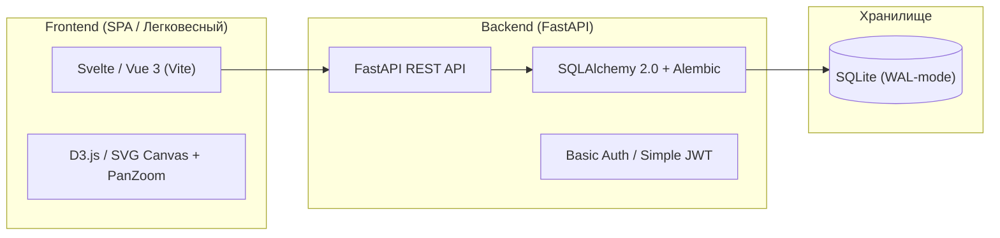
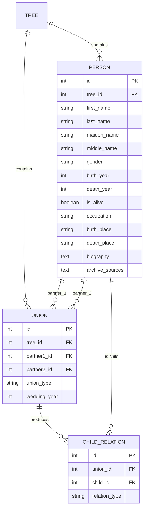

# Техническое задание (ТЗ): Персональная система генеалогического древа

## 1. Введение и цель проекта

### 1.1. Назначение системы
Разработка легковесного, автономного веб-приложения для персонального ведения, структурирования и визуализации масштабного родословного древа (с поддержкой нескольких независимых древ). 

### 1.2. Ключевые принципы разработки
- **Текстоцентричность**: отказ от хранения тяжелых медиа-файлов (фото, сканы) ради минимального размера базы, скорости работы и дешевого хостинга на небольшом VPS.
- **Производительность на больших объемах**: поддержка деревьев от сотен до тысяч персон без подвисаний отрисовки.
- **Автономность и переносимость**: база данных — один файл SQLite с регулярными бэкапами; простое развертывание в Docker.
- **Безопасность**: закрытый доступ по паролю (личный закрытый сервис на удаленном VPS).

---

## 2. Стек технологий

### 2.1. Backend
- **Python 3.11+**
- **FastAPI**: быстрый асинхронный REST API с автоматической документацией Swagger/OpenAPI.
- **SQLAlchemy 2.0**: современный декларативный стиль `Mapped[...]` и `mapped_column`.
- **Alembic**: управление миграциями схемы БД.
- **SQLite**: хранение данных в локальном файле, работа в режиме `WAL` (Write-Ahead Logging) для устойчивости к параллельным чтениям.
- **Pydantic v2**: строгая валидация входящих и исходящих схем данных.

### 2.2. Frontend
- **Ядро**: **Svelte** (рекомендуется за минимальный размер бандла, отсутствие тяжелого Virtual DOM и мгновенный рендеринг) или **Vue 3 (Composition API)**.
- **Сборщик**: Vite.
- **Визуализация графа**:
  - Генеалогическое древо — это DAG (направленный ациклический граф) с объединениями (браками), а не простое дерево.
  - Оптимальный выбор: SVG/Canvas на базе кастомной раскладки поколений либо адаптация `d3-flextree` / `family-chart` с возможностью масштабирования и перемещения (Pan & Zoom).

### 2.3. Визуальный стиль и дизайн-система
> [!NOTE]
> Дизайн разрабатывается в стиле **«Архивный модерн / Теплый академический минимализм» (Warm Archival Minimalist)**, избегая шаблонного вида корпоративных Tailwind-дашбордов.

- **Цветовая палитра**:
  - Фон: теплый бумажный / слоновая кость (`#FBF9F5`, `#F3F0EA`).
  - Карточки персон: молочно-белые (`#FFFFFF`) с деликатной рамкой (`#E2DDD4`).
  - Текст: глубокий графит/угольный (`#23262A`) вместо агрессивного черного.
  - Акценты: приглушенный благородный шалфей/олива (`#405B4D`), охра/терракота (`#B35C37`) для выделения веток и статусов.
- **Типографика**:
  - Заголовки, имена персон: эстетичная антиква (*Spectral* / *Playfair Display* / *Lora*).
  - Интерфейс, даты, метаданные: чистый читаемый гротеск (*Plus Jakarta Sans* / *Inter*).
- **Пластика интерфейса**: скругления 6–8px, тонкие элегантные соединительные линии связей (кривые Безье), отсутствие аляповатых теней.

---

## 3. Модель данных (База данных)

### 3.1. Архитектура связей (Союзы и Родительство)
В генеалогии стандартная ошибка — связывать детей напрямую с двумя родителями. Это ломает логику нескольких браков. Правильная модель базируется на понятии **Союза (Семьи/Брака)**:

### 3.2. Детальный состав полей сущности `Person`

#### А. Обязательные / Базовые (выводятся на карточке в дереве):
- `id` (int, PK)
- `tree_id` (int, FK) — принадлежность конкретному дереву
- `first_name` (string) — Имя
- `last_name` (string, nullable) — Фамилия
- `middle_name` (string, nullable) — Отчество / Патроним
- `gender` (enum: `MALE`, `FEMALE`, `UNKNOWN`) — критично для расчета типов родства (сын/дочь/отец/мать)
- `birth_year` / `birth_date` (int/string, nullable) — год или точная дата рождения
- `death_year` / `death_date` (int/string, nullable) — год или точная дата смерти
- `is_alive` (bool, default: False) — признак "жив"

#### Б. Расширенные / Опциональные (доступны при клике / в шторке):
- `maiden_name` (string, nullable) — девичья фамилия / фамилия до брака
- `is_birth_date_approx` (bool) — дата рождения приблизительна (актуально для старинных метрик: «около 1845 г.»)
- `is_death_date_approx` (bool) — дата смерти приблизительна
- `birth_place` (string, nullable) — место рождения (губерния, уезд, село / город)
- `death_place` (string, nullable) — место смерти
- `burial_place` (string, nullable) — кладбище / место захоронения
- `occupation` (string, nullable) — профессия, род занятий, военный чин, должность
- `social_class` (string, nullable) — сословие (дворянин, крестьянин, мещанин, купец II гильдии и т.д.)
- `confession` (string, nullable) — вероисповедание (православие, старообрядчество, католицизм и др.)
- `archive_sources` (text, nullable) — архивные шифры и реквизиты (ЦГИА/ЦГА/ГАРФ: фонд, опись, дело, лист)
- `biography` (text, nullable, Markdown) — подробная биография, заметки, интересные факты
- `created_at` / `updated_at` (timestamps)

---

## 4. Функциональные требования

### 4.1. Управление деревьями
- Создание нового дерева (название, описание).
- Переключение активного дерева в верхнем меню.
- Удаление дерева (с каскадным удалением всех входящих сущностей с подтверждением).

### 4.2. Управление персонами и связями (CRUD)
- **Создание персоны**:
  - Создание с нуля (корневой предок).
  - Быстрое контекстное добавление: клик по персоне $\to$ «Добавить отца/мать», «Добавить супруга(у)», «Добавить ребенка». При этом автоматически создаются нужные связи и союзы.
- **Редактирование**:
  - Изменение любых полей через боковую панель.
- **Удаление**:
  - Защита целостности: удаление человека разрывает только его союзы и связи; дети и предки остаются в дереве (не удаляются каскадно).
  - Предупреждение о распаде веток, если персона была связующим звеном.
- **Привязка существующих персон**:
  - Возможность объединить две существующие персоны в союз или указать существующую персону как родителя.

### 4.3. Визуализация и навигация
- **Интерактивное полотно (Viewport)**:
  - Плавный Pan & Zoom (колесико мыши, драг полотна, pinch-to-zoom).
  - Кнопка «Сфокусироваться на корневом предке» / «Показать всё древо».
- **Карточка персоны на полотне**:
  - Компактный размер: ФИО, годы жизни (например, `1892 — 1944`), значок пола.
  - Подсветка прямых предков относительно выбранного человека.
- **Боковая панель (Drawer / Slide-over)**:
  - Открывается справа при клике на персону, не закрывая обзор древа.
  - Вкладка «Анкета» (все подробные поля, форматированный Markdown биографии).
  - Вкладка «Ближайшие родственники» (быстрый переход к родителям, братьям/сестрам, супругам, детям).
- **Поиск и фильтры**:
  - Быстрый поиск по фамилии/имени/году (шорткат `Ctrl+K`).
  - Центрирование экрана на найденном человеке.

### 4.4. Резервное копирование и экспорт
- Экспорт выбранного дерева в единый JSON-файл (полный снапшот со всеми связями).
- Импорт дерева из JSON (возможность быстро восстановить данные).
- Механизм создания мгновенного бэкапа SQLite базы (`.backup`).

---

## 5. Архитектура API (Контракты)

| Метод | Эндпоинт | Назначение |
|---|---|---|
| `GET` | `/api/trees` | Список всех деревьев |
| `POST` | `/api/trees` | Создать новое дерево |
| `GET` | `/api/trees/{id}` | Полные данные дерева (персоны + союзы + связи) для отрисовки |
| `POST` | `/api/trees/{id}/persons` | Добавить новую персону |
| `GET` | `/api/persons/{id}` | Детальная карточка персоны |
| `PUT` | `/api/persons/{id}` | Обновить данные персоны |
| `DELETE` | `/api/persons/{id}` | Удалить персону |
| `POST` | `/api/unions` | Зарегистрировать брак/союз между двумя персонами |
| `POST` | `/api/unions/{id}/children` | Привязать ребенка к союзу |
| `DELETE` | `/api/unions/{id}` | Удалить союз |
| `GET` | `/api/trees/{id}/export` | Скачать JSON-дамп дерева |
| `POST` | `/api/trees/import` | Загрузить дерево из JSON |

---

## 6. Требования к развертыванию на VPS

1. **Docker Compose**:
   - Контейнер `app`: FastAPI сервер (Uvicorn).
   - Фронтенд собирается на этапе сборки (multi-stage build) и раздается либо самим FastAPI через `StaticFiles`, либо легковесным reverse-proxy (Nginx / Caddy).
2. **Персистентность**:
   - Файл `data/family_tree.db` монтируется через Docker volume.
3. **Безопасность**:
   - Авторизация через сессию или базовый токен/логин, хранящийся в `.env`, чтобы дерево не было доступно посторонним в открытом интернете.
